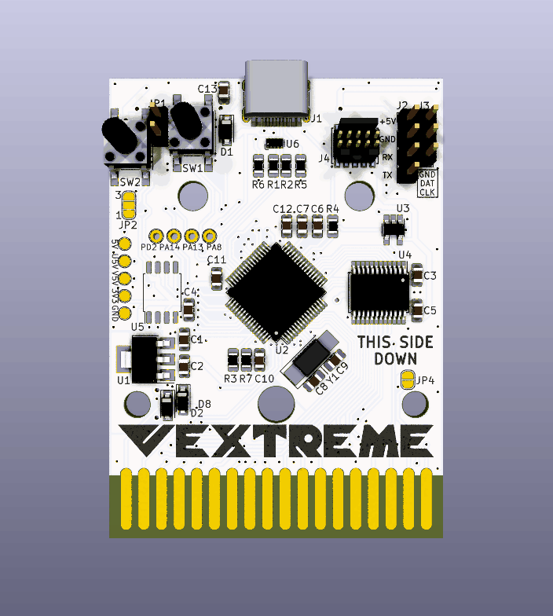

VEXTREME Vectrex Multicart
===

We're carrying on and pushing forward the amazing work of [Sprite_tm](http://spritesmods.com/?art=veccart&page=1) and his Extreme Vectrex Multicart. He posted the code (GPLv3 License) and lots of screens of the PCB/initial schematic, but he never released the PCB. It's a great base for an inexpensive and open vectrex multicart, for developers and players alike!

:warning: Please read this NOTICE of Current Development :warning:
===

**This project is a work in progress, and is not ready for mass production.**  Please observe the currently [posted issues](https://github.com/technobly/vextreme/issues) and there may be more lurking that are not yet identified.  The hardware and software is evolving.  You are free to build any version, contribute and/or follow along.  Please note that support of these pre-releases will be very limited and if you embark on an epic adventure to build one or a few, you should feel comfortable with this type of embedded hardware and software development.  There will be road bumps, but the journey is half the fun of the destination.  When things appear to be stable and we've worked out most of the kinks, we'll change the version to v1.0.  Only then is it advisable to mass produce, after building and testing a prototype first... so you know what you are getting yourself into.

3D Renders
===



Video Updates
===

Be sure to subscribe to my Youtube channel for updates!  Here's my [Vectrex playlist](https://www.youtube.com/watch?v=zkJ-z77fJCw&list=PL7MgXfpGKg6CCaIQejZVb5CsTg3-5mHU0&index=1) if you want to stay laser focused on this project.

VEXTREME Discord Server
===
Join the [VEXTREME Discord server](https://discord.gg/VDssGVJ) to chat with us about the development

BOM and Parts ordering
===

All the parts are described in Bill of Materials [vextreme-v0.x.csv](bom/)

Also, you can use this [Digi-Key shared cart](https://www.digikey.com/short/zpdmtp) if you're in a hurry.  It has will have part references right on the packages for you!

Ordering PCB's
===

OSHPark is a good place to order with purple or the new "after dark" theme color scheme.  You can upload the KiCad [vextreme.kicad_pcb](hardware/vextreme.kicad_pcb) there directly.  I would download this entire Github repo ZIP file first though instead of just trying to save the PCB file from your browser.

Another way to order PCB's is by using the included [gerbers-vextreme-v0.x.zip](gerbers) and uploading those with all of the necessary specs to companies like [PCBWay](https://www.pcbway.com) or [JLCPCB](https://jlcpcb.com)

Building and Flashing STM firmware
===

### This assumes you have these prerequisits installed:

- Docker
- dfu-util
- Make
- Windows will also require these [Zadig instructions](https://github.com/profezzorn/ProffieOS/wiki/zadig)

### Build the stm32-build docker image
```
code/stm32 $ make docker-build
```

### Connect the 2-pin jumper JP1 and then connect the cart to USB

### Check if your computer sees the STM32
```
$ dfu-util -l

dfu-util 0.9

Copyright 2005-2009 Weston Schmidt, Harald Welte and OpenMoko Inc.
Copyright 2010-2019 Tormod Volden and Stefan Schmidt
This program is Free Software and has ABSOLUTELY NO WARRANTY
Please report bugs to http://sourceforge.net/p/dfu-util/tickets/

Deducing device DFU version from functional descriptor length
Found DFU: [0483:df11] ver=2200, devnum=22, cfg=1, intf=0, path="20-1.4.3", alt=3, name="@Device Feature/0xFFFF0000/01*004 e", serial="123412341234"
Found DFU: [0483:df11] ver=2200, devnum=22, cfg=1, intf=0, path="20-1.4.3", alt=2, name="@OTP Memory /0x1FFF7800/01*512 e,01*016 e", serial="123412341234"
Found DFU: [0483:df11] ver=2200, devnum=22, cfg=1, intf=0, path="20-1.4.3", alt=1, name="@Option Bytes  /0x1FFFC000/01*016 e", serial="123412341234"
Found DFU: [0483:df11] ver=2200, devnum=22, cfg=1, intf=0, path="20-1.4.3", alt=0, name="@Internal Flash  /0x08000000/04*016Kg,01*064Kg,03*128Kg", serial="123412341234"
```

### Flash the UF2 Bootloader via dfu-util
```
uf2-stm32f $ dfu-util -a 0 -d 0483:df11 -s 0x08000000:leave -D bootloader.bin
```


### Build and flash the STM32 UF2 image via dfu-util
```
code/stm32 $ make clean all uf2 flash-uf2 USE_HW=v1.0 USE_UF2=1

// NOTE: Use either v0.2, v0.3, v0.4 or v1.0 above depending on which hardware version you have.
// NOTE: You may use v0.3 if you make the proper mods to your v0.2 board.  See "Modifying v0.2 to v0.3"

// You should end up with something like this

Downloading to address = 0x08004000, size = 134144
Download    [=========================] 100%        134144 bytes
Download done.
File downloaded successfully
```

### Remove the cart from USB and remove the jumper (install it on one pin so you don't lose it)

Adding Vectrex Game ROMs (Binaries)
===

- Create a directory on your multicart called `roms/`

- Add your first binaries there, may I suggest: [Beluga Dreams](https://8-bit-waves.itch.io/beluga-dreams) and [Vec-Man](http://eiti.fh-pforzheim.de/personen/johannsen/projektlabor/vectrex_2019/vectrex_game_vec_man.htm) ?

Hall of Fame
===

If you build one of these, be sure to send me a message with your build pics showing your working VEXTREME multicart!  Or better yet, check out the [hall of fame format here](hall-of-fame/) and submit a PR (please and thank you!)

Credits
===

Everyone who has contributed to this project, with a short summary of their contributions can be found here [CREDITS](CREDITS.md)

LICENSE
===

GPLv3 - essentially you must keep this open, all changes must be disclosed and shared.  Full [LICENSE here](LICENSE) and [TL;DR summary here](https://tldrlegal.com/license/gnu-general-public-license-v3-(gpl-3))

Docs
===

A collection of how-tos and lessons learned lives in [docs/](docs/):

- [Firmware Updates](docs/firmware-updates.md) - update VEXTREME firmware over USB with a `VEXTREME.uf2` file
- [Developer Mode](docs/developer-mode.md) - flash a single game over USB and run it immediately
- [Lazy Developer](docs/lazy-developer.md) - automatically ejects the USB drive when the Vectrex is turned on
- [Cart Options](docs/cart-options.md) - per-game `.ini` files to enable cartridge RAM
- [Datasheets](docs/datasheets/) - STM32F411 datasheet and reference manual
